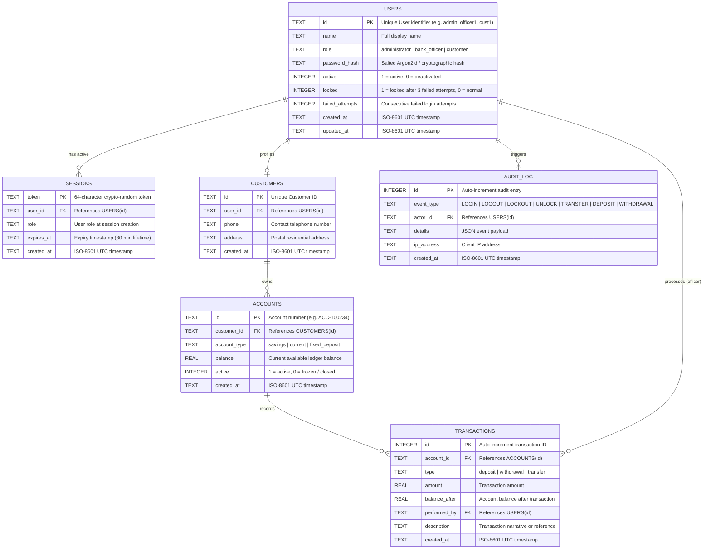

# Bank Management System — Entity Relationship (ER) Diagram

- **Design Document:** ERD-2026-v1.1
- **Component:** Core Database & Relational Schema
- **Story:** [S-34] Fix SRS gaps (#65)
- **Target RDBMS:** SQLite 3 (Foreign Key enforcement enabled)

---

## 1. Visual Entity Relationship Diagram

---

## 2. Table Specifications & Relationships

### `users`
- Central authentication and identity table.
- Stores credentials hashed with Argon2id; tracks consecutive failed login attempts and lockout state (FR-1, FR-2, SEC-2, S-07, S-09).
- Deactivation flags prevent new session creation while preserving foreign-key references on past transactions (S-24).

### `sessions`
- Server-side token store with strict 30-minute expiry (FR-2, SEC-1, S-08).
- Foreign key cascading ensures sessions are cleared immediately upon user deletion or deactivation.

### `customers` & `accounts`
- One-to-many relationship between customers and bank accounts.
- Enforces relational referential integrity (`PRAGMA foreign_keys = ON`).

### `transactions` & `audit_log`
- Append-only transactional ledger with serialized writes via `BEGIN IMMEDIATE` (NFR-3).
- Every balance-modifying event records both the affected account and the initiating user ID.
