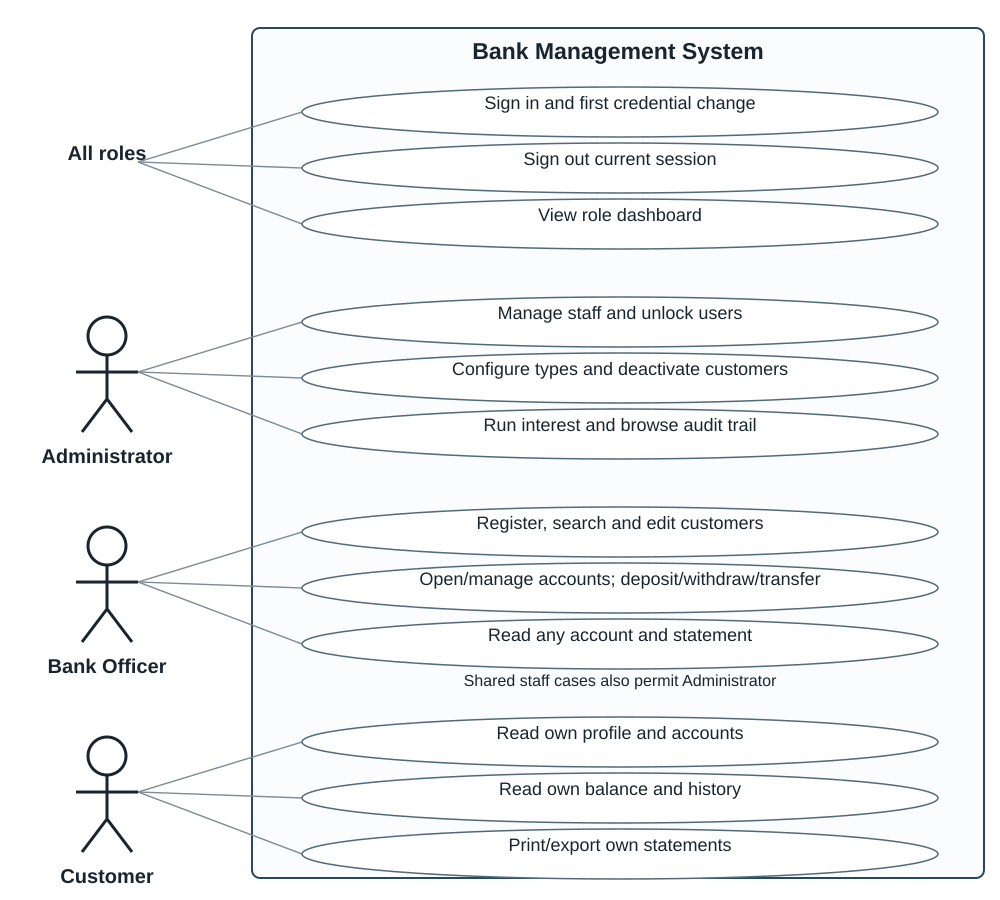
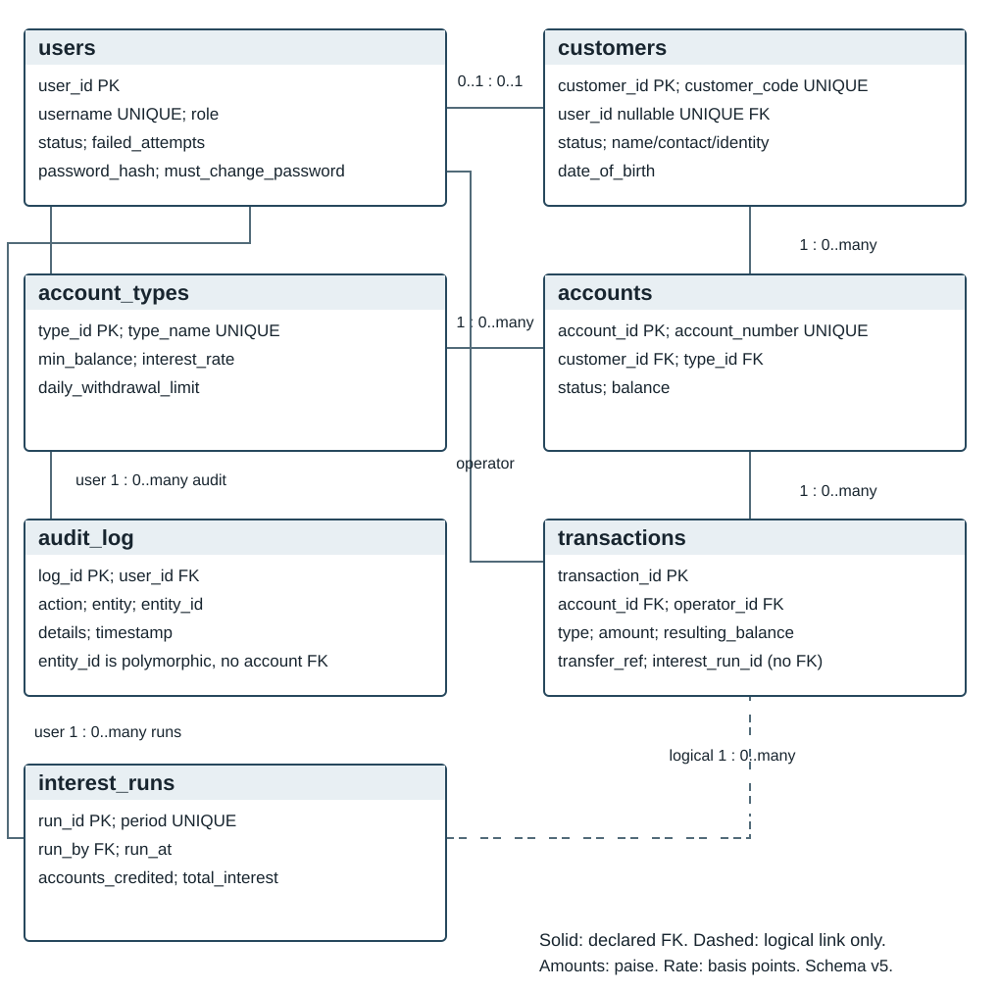

# Bank Management System

Software Requirements Specification

Version 1.2 | 6 November 2026

PES University | Software Engineering and System Design | UE24CS341A

Original team: Abhishek Hanamant Kinagi, Adithya Ajeeth, Aditya M and Aditya Vats.

Revision authors: Adithya Ajeeth (S-44), with Appendix E updated by Aditya Vats (S-46). Review and approval: approved by Aditya Vats, Abhishek Hanamant Kinagi, Adithya Ajeeth and Aditya M on 7 Nov 2026.

This specification defines the single-branch academic banking system and the requirements used to assess it. Version 1.2 consolidates the original IEEE 830-style SRS, the S-34 amendment and documented implementation decisions. It preserves FR-1 through FR-14 and NFR-1 through NFR-9, and adds FR-15 through FR-17 for administrative features already built.

The implementation baseline is main commit `547ffb5b25bc0b8429aae8978581a29620632111`. The validation snapshot is the final S-43 report merged in #135 at `547ffb5b25bc0b8429aae8978581a29620632111`. The final validation exit criteria are NOT MET, because TC-21 was not run (deviation 35). This revision documents the system; it does not certify that every requirement has passed acceptance testing.

<!-- pagebreak -->

## Revision History

| Version | Date | Author | Changes |
|---|---|---|---|
| 1.0 | 2 Sep 2026 | Original project team | Initial IEEE-style SRS, 14 FRs and 9 NFRs. |
| 1.1 | 1 Nov 2026 | Abhishek Kinagi and team | S-34 addendum: three security objectives, use case model, corrected course references and ER model reference. Merged through PR #104. |
| 1.2 | 6 Nov 2026 | Adithya Ajeeth; Appendix E update by Aditya Vats | Rebuilt an editable source from the original PDF with user authorization. Integrated S-34 into the specification and rendered both models. Reconciled requirement text with deviations rows 3-4, 7, 9-14, 17-24. Retained the provisional interest basis (row 6). Added FR-15 to FR-17, BR-1 to BR-10 and SEC-1 to SEC-6. Corrected S-34's logout scope and recorded remaining gaps in rows 33-34. Added traceability to the merged S-41/S-43 baselines. On 7 Nov 2026, Appendix E was updated to the final S-43 report (#135). |

## Contents

- Section 1: Introduction
- Section 2: Overall Description
- Section 3: External Interface Requirements
- Section 4: System Features
- Section 5: Other Nonfunctional Requirements
- Section 6: Other Requirements
- Appendix A. Glossary
- Appendix B. Analysis Models
- Appendix C. To Be Determined List
- Appendix D. Future Enhancements
- Appendix E. Requirement Traceability
- Appendix F. Reconciliation Notes

## 1. Introduction

### 1.1 Purpose

This Software Requirements Specification describes the Bank Management System developed for the Software Engineering mini-project. It covers customer and account management, deposits, withdrawals, internal transfers, balances, transaction history, interest, statements and administration. The browser supplies presentation and data entry; the C++ core makes banking decisions and persists them in SQLite. There are no separate subsystem SRS documents.

### 1.2 Document Conventions

“Shall” identifies a mandatory requirement. FR identifies a functional requirement, NFR a nonfunctional requirement, SEC a security requirement, SO a security objective and BR a business rule. Existing FR and NFR numbers are unchanged. A feature's High or Medium priority applies to its requirements unless stated otherwise. Monetary amounts are INR, persisted as integer paise; annual interest rates are stored as integer basis points. Dates and transaction timestamps use UTC unless explicitly described as display values.

An implemented behavior is not automatically a validated requirement. Appendix E imports acceptance statuses from S-43. New acceptance criteria specify checks to perform; they are not claims that those checks were run. References to numbered deviations mean the rows on this branch's `docs/DEVIATIONS.md` at the recorded baseline.

### 1.3 Intended Audience and Reading Suggestions

The audience is the four-person project team, course instructor, viva evaluators, developers and testers. Sections 1-2 describe scope and assumptions. Sections 3-5 define interfaces, functions and quality requirements. Section 6 preserves course constraints. Appendices provide models, decisions and the requirement-to-design-to-test mapping.

### 1.4 Product Scope

The system is a simplified single-branch, single-currency application. Administrators manage Bank Officers, account types and locked users, inspect audit entries, run interest and view summaries. Administrators and Bank Officers maintain customer details, open and manage accounts and process transactions. Only Administrators deactivate customers. Customers have read-only access to their own profile, accounts, balances, history and statements; a first-login credential change is the exception to read-only banking access.

Loan/EMI management, fixed or recurring deposits, cheque clearing, cards, ATM integration, interbank payment networks, multi-branch operation, multi-currency operation and joint accounts are outside scope. The project is not connected to a real bank and is not intended to hold real customer funds.

### 1.5 References

| Reference | Document and purpose |
|---|---|
| R-1 | IEEE Std 830-1998, IEEE Recommended Practice for Software Requirements Specifications; structural reference. |
| R-2 | Software Engineering and System Design, UE24CS341A, PES University, academic year 2026-2027; course SRS template, syllabus and deliverable guidelines cited by S-34. The course template, Deliverables Part-1 and Mini-project FAQ files are not present in the repository; no independent compliance claim is made for their unseen text. |
| R-3 | Karl E. Wiegers, Software Requirements Specification template, 1999; original SRS structural template. |
| R-4 | OWASP API Security Top 10, 2023 edition; background reference added by S-34, not a security certification. |
| R-5 | `docs/Software_Architecture_and_Design_Specification.docx`, merged main baseline, sections 2.2-2.4 and 3.2-3.4; design components, API and data design. S-46 PR #129 is unmerged and is not the approved design baseline. |
| R-6 | `docs/decisions/001-tech-stack.md`, `002-account-types-and-withdrawal-limit.md` and `003-interest-calculation-basis.md`; accepted stack/type decisions and provisional interest basis. |
| R-7 | `docs/DEVIATIONS.md`, main baseline plus S-44 rows 33-34; accepted differences and unresolved disagreements. |
| R-8 | S-41 PR #124, `docs/TEST_PLAN_CONSOLIDATED.md`, commit `cc4b10200c531687aae83b855c5a59b246c25b37`; merged Test Plan v1.2 and TC IDs. MERGED in #124. |
| R-9 | S-43 PRs #130 and #135, `docs/System_Validation_Report.md`; final validation statuses at commit `547ffb5b25bc0b8429aae8978581a29620632111`. MERGED in #135. |
| R-10 | `db/schema.sql` schema version 5, `db/migrations/`, `db/seed.sql`, `src/` routes and `frontend/`; implementation facts checked for this revision. |
| R-11 | `docs/S-13-MANUAL-TEST.md`, `S-14-MANUAL-TEST.md`, `S-15-MANUAL-TEST.md`, `S-16-MANUAL-TEST.md`, `S-21-MANUAL-TEST.md`; supplementary procedures, not proof of execution. |

## 2. Overall Description

### 2.1 Product Perspective

The product is a standalone academic client-server application. Its four logical layers are Presentation, API/Gateway, C++ Business Logic and Data, as described in SADS section 2.1. HTML/CSS/JavaScript consumes a same-origin JSON API served by cpp-httplib. SQLite stores related records and performs atomic transactions. The browser contains no authoritative balance-changing logic.

### 2.2 Product Functions

The system provides authentication, lockout, session termination and first-login credential change; customer registration, search, view, editing and deactivation; account opening, status transitions and type configuration; atomic deposits, withdrawals and transfers; owned account access, dated history and statements; once-per-period interest; staff administration, user unlocking and role dashboards; and append-only financial auditing with an Administrator viewer.

### 2.3 User Classes and Characteristics

| Role | Characteristics and access |
|---|---|
| Administrator | Semi-technical staff member responsible for oversight. Manages officers and account types, unlocks users, deactivates customers, runs interest and reads the audit trail. May also perform staff banking operations. |
| Bank Officer | Primary day-to-day operator with basic computer literacy. Registers and edits customers, opens/manages accounts and processes transactions. May view account types and permitted customer/account data, but cannot configure types, unlock users, deactivate customers or manage staff/audit access. |
| Customer | Basic computer literacy; views only their own profile, accounts, balances, history and statements. Cannot initiate banking operations that change a balance. |

### 2.4 Operating Environment

The client runs in a current Chrome or Firefox browser on an ordinary desktop/laptop. The C++17 server builds on Windows and Linux with CMake and a compatible compiler. SQLite is embedded; no separate database server is required. The demo uses a laptop with browser, backend and database co-located. Local development uses loopback HTTP with fictional data. Network use requires a TLS-enabled build, OpenSSL and configured certificate/private-key paths. Chrome/Firefox compatibility remains an acceptance target, not an established result in the current S-43 window.

### 2.5 Design and Implementation Constraints

The banking core shall be implemented in C/C++ and organized into functional modules. Only Administrator, Bank Officer and Customer roles are supported. The system shall remain single-branch and INR-only. SQLite foreign keys and transactions shall preserve referential integrity and financial atomicity. Writes use a database-wide `BEGIN IMMEDIATE` transaction rather than record-level locks; see DEVIATIONS.md row 1. HTML/CSS/JavaScript is the presentation stack; cpp-httplib, nlohmann/json and libsodium are the selected API/JSON/credential dependencies (ADR 001). Git and GitHub shall manage collaborative development. Native mobile apps and real financial integrations are excluded.

### 2.6 User Documentation

The README supplies build/run instructions, TLS configuration and demo links. Field labels, validation errors, confirmation dialogs and success messages provide in-application guidance. The repository retains the SRS source/PDF, SADS, test plans, manual procedures and reports for team and evaluator reference; a separate formal user manual is not required by this scope.

### 2.7 Assumptions and Dependencies

There is no public self-registration. Authorized staff provision users; a seeded Administrator bootstraps the demo. A customer may own multiple accounts, including more than one of a type; each account has exactly one customer and one type. Customer login linkage is optional at schema level and unique when present. Cash handling occurs outside the system. A correct server clock, working browser connection, writable SQLite database and C++ toolchain are assumed. The first build may require dependency downloads. Account-type settings govern future operations, not retroactive ledger changes. See DEVIATIONS.md rows 10, 12 and 20.

## 3. External Interface Requirements

### 3.1 User Interfaces

The system shall provide consistent browser navigation, sign-in, role dashboards, forms, detail views and paginated tables. Password fields shall be masked. Staff banking actions shall require confirmation identifying account(s) and amount before submission, followed by a clear success or failure result and the resulting balance on success. Account opening has a review/back/confirm flow. The original v1.0 wording also required a resulting balance before every commit; current withdrawal/transfer dialogs do not provide that preview. This narrower documented behavior is an explicit unresolved reconciliation, not a silent claim of compliance; see DEVIATIONS.md row 34 and Appendix F.

Customers shall receive only their own banking data. Hidden controls alone shall not be considered authorization. Date-range, empty, loading and failure states shall remain understandable, and rejected forms should retain values where supported. NFR-6 and NFR-9 define the usability and browser acceptance targets.

### 3.2 Hardware Interfaces

No specialized hardware is required. Standard computing devices capable of a modern browser and the C++ server are sufficient. The system has no interface to cash dispensers, card readers, passbook printers or other banking peripherals.

### 3.3 Software Interfaces

The API shall exchange JSON over HTTP/HTTPS and use SQLite for persistence. Login accepts `username` and `password`, not a `user_id` JSON key. Successful login returns a bearer access token and role. Business routes authenticate sessions and apply role/ownership checks. Invalid input, authorization failures and business-rule violations shall return structured responses without applying rejected financial changes.

Customer self-service uses `GET /customers/me` and `GET /customers/me/accounts`. Staff retrieve a customer's account list inside `GET /customers/{id}`; there is no separate implemented `GET /customers/{id}/accounts` route. Balance/history/statement routes use an account number. See DEVIATIONS.md rows 9, 18-19 and 24. Appendix E maps requirements to concrete routes; the SADS remains the detailed API design reference, with disagreements listed in Appendix F.

### 3.4 Communications Interfaces

All network-accessible deployment communication shall use HTTPS/TLS. Plain HTTP is permitted only for local development/testing with fictional data. The default build does not provide HTTPS; TLS requires its build option, OpenSSL and certificate/key configuration. Sign-in, credential delivery and personal-data routes reject network-accessible plain HTTP listeners. Other authenticated routes do not independently enforce transport on every call, so deployment configuration must enforce the network HTTPS rule. A TLS listener refuses plaintext HTTP; automatic HTTP-to-HTTPS upgrade is not required. No email, SMS or interbank communication service is used. See DEVIATIONS.md rows 3, 7, 9, 12-13 and 23.

## 4. System Features

### 4.1 User Authentication and Session Management

#### 4.1.1 Description and Priority

High. Authenticate each role, authorize requests in the backend, enforce the three-failure lockout and control session expiry/termination. Admin unlock is separately identified by FR-16 without removing its original FR-2/FR-13 scope.

#### 4.1.2 Stimulus and Response Sequences

- An active user submits valid credentials: authenticate, reset failed attempts, issue a 64-character token and show the role dashboard; a newly provisioned user must first change the temporary password.
- An active user submits incorrect credentials: the first two failures return generic HTTP 401; the third locks the user and returns `ACCOUNT_LOCKED` with Administrator contact guidance.
- A user logs out: remove the submitted bearer token and return HTTP 204; subsequent protected use of that token returns 401 and the UI returns to sign-in.
- A session reaches 30 minutes from sign-in, or the user becomes inactive/locked: deny protected requests. Restart loses all in-memory sessions. Logout removes the current token, not every token issued to that user.

#### 4.1.3 Functional Requirements

**FR-1 — Authentication and authorization.** The system shall authenticate active registered Administrators, Bank Officers and Customers using a username and password and shall direct them to the appropriate role view. The C++ backend shall enforce role and ownership restrictions on protected operations independently of visible controls. The current credential interface is password-based; there is no separate PIN workflow. Priority: High. Acceptance: TC-01 role-correct login plus direct forbidden-route/ownership requests; TC-15 covers the TLS login configuration.

**FR-2 — Session lifecycle and lockout.** The system shall permit logout of the current session, return HTTP 204 and reject replay with HTTP 401. Sessions shall use random 64-character bearer tokens with a fixed 30-minute lifetime from sign-in. The third consecutive failed sign-in for an active user shall lock that user; successful sign-in resets the counter. Only an Administrator may unlock a locked user. All protected requests shall reject inactive/locked users. Priority: High. Acceptance: TC-02, TC-02B and TC-03; expiry additionally needs the session-expiry automated checks. See DEVIATIONS.md rows 3, 23 and 34 for the correction to S-34's all-sessions-on-logout wording.

### 4.2 Customer Record Management

#### 4.2.1 Description and Priority

High. Administrators and Bank Officers maintain customer identity/contact records; only Administrators deactivate customers. Customers can read their own profile.

#### 4.2.2 Stimulus and Response Sequences

- Staff submit valid mandatory details: create a unique customer code and linked login with one-time initial credentials.
- Missing or invalid fields: reject with field errors; do not create a partial customer/login.
- Staff search, view or edit an existing record: return/update permitted fields and preserve immutable identifiers.
- An Administrator deactivates a customer: retain records/history, mark the customer and linked login inactive, deny new accounts and subsequent authenticated use. Repeating deactivation is idempotent; Bank Officer/Customer requests are forbidden.

#### 4.2.3 Functional Requirements

**FR-3 — Customer lifecycle.** The system shall allow Administrators and Bank Officers to register, search, view and edit customers with name, date of birth, address, phone, email and identification reference, assigning a unique customer code. Only Administrators shall deactivate customers. Customer lifecycle status is separate from linked user status; contact edits shall not rename the login. Inactive customer/account/audit records shall remain retained, and new account opening and linked-user sign-in shall be refused. Customer reactivation is not provided. A customer shall read only their own profile. Initial customer credentials may be returned once to authorized staff for handoff, with hashed persistence and forced change. Priority: High. Acceptance: TC-04 and TC-04B, supplemented by the S-13 manual procedure and customer search/update tests; those extra flows are not fully covered by these two master cases. See DEVIATIONS.md rows 3-4 and 9-11.

### 4.3 Account Management

#### 4.3.1 Description and Priority

High. Administrators and Bank Officers open and manage customer accounts. Account type configuration is specified separately by FR-15.

#### 4.3.2 Stimulus and Response Sequences

- Staff select an active customer, type and initial deposit: validate, create a unique active account and record its first deposit and audit entry atomically.
- Below-minimum opening: return HTTP 422 with no created account/ledger rows. A zero opening deposit is allowed only for a zero-minimum type.
- Freeze/unfreeze: perform valid status transitions; frozen accounts reject financial transactions but remain readable.
- Close: permit an active or frozen zero-balance account to close; refuse nonzero balance with HTTP 409. Repeated current actions are idempotent, and retained history remains visible.

#### 4.3.3 Functional Requirements

**FR-4 — Account opening.** The system shall allow a Bank Officer or Administrator to open an account for an active registered customer with one configured type and an initial deposit at least its minimum. It shall assign a unique account number and atomically create the account, opening deposit transaction and audit entry. A zero deposit shall be recorded for a zero-minimum type; ordinary cash deposits under FR-6 remain positive. Priority: High. Acceptance: TC-05 and S-15 review/back/confirm instructions. See DEVIATIONS.md row 20 and schema migration 005.

**FR-5 — Account status and retention.** A Bank Officer or Administrator shall be able to freeze, unfreeze and close an account. Frozen or closed accounts shall reject deposits, withdrawals and transfers while preserving permitted views. Only a zero-balance active or frozen account may close. The system shall retain accounts and transaction history without permanent deletion. Repeating the current action shall not duplicate the audit change. Priority: High. Acceptance: TC-07 and S-16 manual notes, including HTTP 409 for nonzero closure and HTTP 422 for a financial operation on a nonactive account. See DEVIATIONS.md row 13.

### 4.4 Deposit and Withdrawal Transactions

#### 4.4.1 Description and Priority

High. Staff process positive INR amounts on active accounts with confirmation, business-rule validation and an atomic ledger/audit commit.

#### 4.4.2 Stimulus and Response Sequences

- Staff confirm a valid deposit: credit the active account, write transaction/audit records and show the new balance.
- Staff confirm a valid withdrawal: debit the account and commit the corresponding records.
- A withdrawal breaches the minimum or cumulative daily limit: reject with a specific reason and leave balance/history unchanged.
- A cash deposit/withdrawal is zero, negative, malformed or targets a nonactive account: reject without a financial mutation.

#### 4.4.3 Functional Requirements

**FR-6 — Deposit.** A Bank Officer or Administrator shall be able to deposit a positive amount into an active account. The operation shall update balance and record amount, type, timestamp, resulting balance and authenticated operator, together with its audit entry, in one transaction. Priority: High. Acceptance: TC-08 confirmation and ledger verification. See DEVIATIONS.md row 23 for Administrator access and row 34 for the pre-commit balance-preview gap.

**FR-7 — Withdrawal.** A Bank Officer or Administrator shall be able to withdraw a positive amount from an active account only if the resulting balance is at least the current type minimum and that account's cumulative withdrawals in the UTC calendar day remain within its current type's daily limit. Zero daily limit permits no withdrawals. Rejected withdrawals shall identify the rule and leave financial state unchanged. Outgoing transfers do not consume this withdrawal total, but must respect the source minimum. Priority: High. Acceptance: TC-06 and TC-09, including rejection state and the UTC boundary. See DEVIATIONS.md rows 12, 21 and 23.

### 4.5 Fund Transfer

#### 4.5.1 Description and Priority

High. Move money between different active bank accounts as a single indivisible operation.

#### 4.5.2 Stimulus and Response Sequences

- Staff confirm a valid source, destination and positive amount: debit/credit and write paired records with one reference.
- Same account, insufficient source balance/minimum, or nonactive endpoint: reject without balance/ledger change.
- A failure occurs before commit: roll back the database transaction in full; do not write a separately committed compensating debit reversal.

#### 4.5.3 Functional Requirements

**FR-8 — Atomic internal transfer.** A Bank Officer or Administrator shall be able to transfer a positive amount between different active accounts, preserving the source minimum balance. Both balance updates, the two linked debit/credit entries and their audit records shall commit together or none shall commit. The two transaction rows shall share a common transfer reference. Priority: High. Acceptance: TC-10 and TC-10B, with failure rollback verification from transfer tests. The rollback wording replaces the original stimulus's compensating reversal; see DEVIATIONS.md rows 21-23.

### 4.6 Balance Inquiry and Transaction History

#### 4.6.1 Description and Priority

High. Customers see owned accounts only. Bank Officers and Administrators can inspect any account for staff operations.

#### 4.6.2 Stimulus and Response Sequences

- Customer opens Accounts: list owned accounts with number, type, status and balance.
- Authorized user opens History: return newest-first transactions, signed amounts and resulting balances.
- User filters an inclusive UTC date range or pages through history: preserve range/order and a stable snapshot for pagination.
- Customer requests another customer's or nonexistent account: return the same HTTP 403 and attempt to audit the refusal without disclosing ownership.

#### 4.6.3 Functional Requirements

**FR-9 — Balance and account views.** A Customer shall view each owned account's current balance, type and status. Bank Officers and Administrators shall view balances of any account through staff account routes. `GET /customers/me/accounts` itself is Customer-only; staff use customer detail/account routes. Priority: High. Acceptance: TC-11 and TC-19. See DEVIATIONS.md rows 18 and 24.

**FR-10 — Dated transaction history.** A Customer shall view only owned account history; Bank Officers and Administrators may view any account. Entries shall be reverse chronological, filterable by inclusive UTC `from`/`to` dates, and show date/time, type, signed amount and resulting balance. Pagination shall preserve the returned snapshot ceiling so new records do not shift existing pages. Customer cross-account/nonexistent requests shall share the same 403 response. Denied history requests shall be audited when audit storage is available; failure to write a refusal audit shall not grant access or change the 403. Priority: High. Acceptance: TC-11, TC-17 and TC-19, plus S-21 supplementary procedures. See DEVIATIONS.md row 19.

### 4.7 Interest Computation and Account Statements

#### 4.7.1 Description and Priority

Medium. Administrators run completed-period interest. Authorized users produce historical account statements and printable/CSV exports.

#### 4.7.2 Stimulus and Response Sequences

- Administrator runs interest for a completed UTC month: determine eligible active interest-bearing accounts, calculate positive rounded credits and record the run/transactions/audits atomically.
- A processed period is requested again: reject without duplicate credit.
- User selects account/date range: show chronological entries, opening and closing balance; a no-transaction period shows no entries and an unchanged balance.
- User exports a statement: generate a print-friendly page or CSV; no dedicated statement PDF exporter is implemented.

#### 4.7.3 Functional Requirements

**FR-11 — Once-per-period interest.** The system shall allow only an Administrator to run interest for a completed `YYYY-MM` UTC month and shall credit eligible active interest-bearing accounts at most once per account/period. Each positive rounded credit shall create a transaction and audit entry; a zero-credit run shall still prevent a duplicate period run. Priority: Medium. Acceptance: TC-09B, supplemented by interest calculation tests. The implemented basis is month-end balance times annual basis points times days in month, divided by 10,000 times days in year, rounded half-up to paise. Historical balance is reconstructed from the ledger, falling back to unchanged stored balance where necessary. This calculation basis remains PROVISIONAL pending repo-owner confirmation of ADR 003; this SRS does not declare that approval complete. See DEVIATIONS.md row 6 and Appendix C.

**FR-12 — Statement and export.** The system shall produce a statement for a permitted account and inclusive UTC date range with opening balance, chronological signed entries and closing balance. Customers may use only owned accounts; Bank Officers and Administrators may use any account. The UI shall support a printable view and downloadable CSV with quoted fields and protection against formula-leading cell content. Priority: Medium. Acceptance: TC-18; the native browser save step remains an evidence gap. Opening balance shall follow the last preceding ledger balance or infer it by reversing the earliest later transaction; absent ledger entries, use the stored unchanged balance. See DEVIATIONS.md row 14.

### 4.8 Staff Management and Role Dashboards

#### 4.8.1 Description and Priority

Medium. Administrators manage Bank Officers. Each authenticated role receives a relevant summary and navigation links.

#### 4.8.2 Stimulus and Response Sequences

- Administrator creates an Officer: store the hash, return a one-time temporary password and require its change before banking use.
- Administrator renames, deactivates or reactivates an Officer: preserve the user ID/history; inactive users cannot authenticate or use protected routes.
- Administrator opens Dashboard: show customer/account/active-officer counts and today's transaction volume, excluding paired transfer credits from double-counted volume.
- Officer opens Dashboard: show transactions processed by that Officer today. Customer opens Dashboard: show owned accounts/balances and history/statement links.

#### 4.8.3 Functional Requirements

**FR-13 — Staff administration.** Only Administrators shall create, list, rename, deactivate and reactivate Bank Officer users. Deactivation shall prevent further login/protected use while retaining operator identity on historic records. Creation shall return initial credentials once, store only their Argon2id hash and require first-login change. Administrative unlocking remains part of this original scope and is detailed by FR-16. Priority: Medium. Acceptance: TC-02B, TC-12 and TC-13; rename/reactivate requires supplementary staff tests. See DEVIATIONS.md rows 7 and 23.

**FR-14 — Role dashboards.** The system shall provide a dashboard after login with role-specific summaries and quick links: system counts/day totals for Administrators; the Officer's processed-day activity for Bank Officers; owned accounts/balances and history/statement links for Customers. Priority: Medium. Acceptance: TC-14 and the NFR-2 timing checks. The implemented aggregation day is UTC; future-dated fixtures are not real current activity.

### 4.9 Account Type Management

**FR-15 — Account type configuration.** Priority: Medium. Role: Administrator writes; Administrator and Bank Officer read. The system shall allow Administrators to create and update uniquely named account types with minimum balance, annual interest rate and daily withdrawal limit, and shall allow authorized staff to list them. Minimum balance and daily limit shall lie between INR 0.00 and INR 10,000,000.00; annual rate between 0.00% and 20.00%. Zero daily limit shall prohibit withdrawals. Changes shall govern subsequent operations without rewriting prior balances or ledger rows. Acceptance: authorized writes succeed; Officer/Customer writes are forbidden; duplicate names ignoring case and out-of-range/invalid decimals are rejected; listing supports account opening; existing ledger rows remain unchanged. See DEVIATIONS.md row 12. S-14 manual notes and account-type automated tests are supplementary; S-41 has no dedicated full CRUD case for this new ID.

### 4.10 Administrative Unlock

**FR-16 — Locked-user recovery.** Priority: High. Role: Administrator. The system shall list locked users and allow an Administrator to unlock a customer or staff user via `PATCH /users/{id}/unlock`, returning active status and resetting failed attempts to zero. Bank Officers and Customers shall not perform this operation. Acceptance: TC-02B validates successful recovery; direct unauthorized requests shall return 403, and recovered users shall be able to log in with valid credentials. This makes the existing FR-2/FR-13 recovery obligation independently traceable; it does not replace those IDs. See DEVIATIONS.md row 23.

### 4.11 Audit Trail Viewer

**FR-17 — Administrative audit browsing.** Priority: Medium. Role: Administrator. The system shall provide `GET /audit` and a read-only UI listing newest log IDs first, with optional inclusive date range and account filters and limit/offset pagination. Each result shall identify timestamp, operator, action, entity and details. Default page limit is 100 and maximum 500. Bank Officers and Customers shall be denied audit reads. No application role shall update or delete audit records; unsupported mutation methods return 405. Acceptance: role-denial checks, correct newest-first/filter/pagination results and rejected mutation attempts. TC-16 covers financial entries/immutability, but does not fully validate viewer filters, pagination or role barriers; use the existing audit-viewer automated tests and add explicit S-41 coverage. See DEVIATIONS.md row 23.

## 5. Other Nonfunctional Requirements

### 5.1 Performance Requirements

**NFR-1 — Transaction latency.** The system shall complete a deposit, withdrawal or transfer, including persistence, within 2 seconds under normal usage with up to a few thousand accounts. Acceptance: TC-20 records persisted response times on approximately 3,000 accounts. Historical measurements in S-43 do not establish a final fresh-seed pass.

**NFR-2 — Standard view latency.** Dashboards, account lists and transaction history shall load within 3 seconds under the same conditions. Acceptance: TC-14 and TC-19. API response timing does not establish full browser rendering time; preserve that distinction in evidence. See DEVIATIONS.md row 16.

### 5.2 Safety Requirements

The system controls no physical or safety-critical equipment. Its safety concern is financial data integrity.

**NFR-3 — Financial atomicity.** Every balance change shall commit together with its transaction/audit records or roll back completely. No financial operation shall produce a negative balance; account opening, withdrawal and outgoing transfer shall enforce the applicable minimum. A zero-balance account may be closed even where its type minimum is positive. A type-configuration increase shall not rewrite existing balances or historic entries; subsequent debits/openings use the new rule. Thus the original “never below minimum through any operation” wording is scoped explicitly to avoid contradicting zero closure and non-retroactive type updates. Acceptance: TC-10/TC-10B plus rollback and accounting tests. See DEVIATIONS.md rows 1, 12-13 and 22 and reconciliation row 34.

### 5.3 Security Requirements

#### 5.3.1 Security Objectives

**SO-1 — Least privilege.** Backend role and ownership checks shall keep administrative operations from Customers/Bank Officers and limit Customers to their own data. Direct API calls shall not bypass hidden UI controls.

**SO-2 — Resilient authentication.** Salted Argon2id hashes and a third-failure lockout shall protect stored credentials and limit repeated online guessing; only an Administrator may restore a locked account.

**SO-3 — Session integrity.** Random short-lived tokens shall be rejected after logout, expiry, restart or inactive/locked user detection. Logout invalidates the current token only. S-34's broader all-sessions wording is corrected and explicitly recorded in DEVIATIONS.md row 34.

#### 5.3.2 Nonfunctional Security Requirements

**NFR-4 — Credential protection and authorization.** The system shall persist only salted Argon2id password hashes, mask credential entry and enforce backend role/ownership permissions on protected requests. It shall not log plaintext passwords. The original absolute prohibition on plaintext transmission/display is replaced by the accepted exception: customer/staff creation returns a temporary password once for authorized handoff, and login/first-password-change necessarily submit a password over loopback fictional-data HTTP or configured HTTPS. The browser shall not persist bearer tokens in local/session storage. No separate PIN interface or encrypted-at-rest database is claimed. Acceptance: TC-01, TC-15 and password/authorization tests, with the provisioning exception checked separately. See DEVIATIONS.md rows 3, 7 and 9.

**NFR-5 — Append-only financial audit.** Every successful balance-changing operation shall record timestamp, affected account/entity, amount and authenticated operator within the same transaction. Application roles shall not edit/delete audit entries, and database triggers shall prevent updates/deletes to audit and transaction rows. This is append-only integrity, not a claim of cryptographic tamper evidence against a privileged database/file administrator. Acceptance: TC-16 and atomic audit tests. Financial audit-write failure must roll back the financial operation; refusal-audit failure must not grant access. See DEVIATIONS.md row 19 for the distinct refused-read behavior.

#### 5.3.3 Security Requirement Table

SEC-1 to SEC-4 retain the design specification's meanings. S-41 combines hashing and HTTPS under SEC-2; SEC-3 below makes the transport rule explicit without renumbering existing references. SEC-5 and SEC-6 make lockout and session lifecycle separately testable.

| ID | Requirement | Acceptance criteria |
|---|---|---|
| SEC-1 | Authenticate protected business requests and enforce backend role/ownership checks. | Invalid/expired tokens receive 401; unauthorized authenticated operations receive 403; own-data access works while cross-account access is denied. TC-03, TC-11, TC-13; account/staff deactivation and RBAC tests supplement them. |
| SEC-2 | Store salted Argon2id hashes; do not log plaintext or persist browser tokens. Permit only the documented one-time initial-credential handoff exception. | Login success does not echo a password; database has hashes, not initial passwords; first-login access is restricted until change. TC-01/TC-12 plus credential/provisioning tests. HTTPS is also linked to SEC-2 in S-41 via TC-15. |
| SEC-3 | Require HTTPS/TLS for network deployments; allow fictional-data loopback HTTP for development/demo. | TLS 1.3 handshake and HTTPS sign-in succeed on configured TLS build; plaintext on TLS listener fails. Network HTTP sign-in/credential routes are refused. TC-15 plus listener configuration tests; default build is not HTTPS. |
| SEC-4 | Preserve append-only financial audit and restrict the audit viewer to Administrators. | Financial transaction and audit commit atomically; update/delete requests return 405; non-Admin reads return 403. TC-16 plus audit-viewer role tests; no cryptographic tamper-proof claim. |
| SEC-5 | Lock an active user on the third consecutive failed login; only Admin may unlock. | First two failures are generic 401; third is 401 ACCOUNT_LOCKED; unlock resets status/failure count and permits login. TC-02/TC-02B, supplemented by unauthorized unlock checks. |
| SEC-6 | Use random 64-character tokens with 30-minute fixed expiry; invalidate the current token on logout and reject inactive/locked users. | Logout 204 then old-token protected request 401; UI returns to sign-in. Expiry/restart/deactivation also reject tokens; other active sessions are not claimed to be globally logged out. TC-03/TC-13 plus auth-session tests. |

### 5.4 Software Quality Attributes

**NFR-6 — Usability.** At least three genuine first-time representative participants shall complete core tasks unaided on their first attempt. TC-21 specifies both the Bank Officer deposit and Customer history lookup, with 100% task completion without verbal prompts and recorded findings. TC-21 was not run and is recorded as deviation 35, so this requirement is not validated.

**NFR-7 — Reliability and input handling.** The system shall reject empty mandatory fields, malformed/unknown account identifiers and invalid or nonpositive ordinary transaction amounts with clear errors, without crashing or applying the rejected financial operation. Intentional security bookkeeping, such as failure counters, lockout and refused-request audit entries, may change on a rejected request; this qualifies the original blanket “no record” statement rather than contradicting FR-2/NFR-5. Zero opening deposits follow FR-4 only. Acceptance: TC-02, TC-06, TC-09, TC-10B and TC-11. Account identifiers are bounded to 1-32 ASCII letters/digits/hyphens/underscores and customer-search input to 100 UTF-8 bytes; see DEVIATIONS.md row 17 and reconciliation row 34.

**NFR-8 — Maintainability.** The C++ backend shall be modular by function, including authentication, customers, accounts, transactions, reporting, staff, auditing and common data/API support. Acceptance: CMake/module inspection and CTest; the final S-43 report records this requirement as Validated.

**NFR-9 — Portability.** The C++ core shall build and run on Linux and Windows without platform-specific business-logic paths. The frontend shall function correctly in current Chrome and Firefox without browser-specific modifications. Acceptance: TC-22 builds and core/responsive browser flows. The final S-43 report records fresh Chrome and Firefox core and responsive runs passing after the SV-01 table fix, with Ubuntu and Windows CI, and validates this requirement within that recorded scope.

### 5.5 Business Rules

The original eight unnumbered business rules are identified as BR-1 to BR-8 for reference; BR-9 and BR-10 make existing timing/configuration decisions explicit. These IDs do not replace FRs/NFRs.

| ID | Business rule |
|---|---|
| BR-1 | Only Administrators may create/modify/deactivate/reactivate Bank Officers or write account-type parameters. Only Administrators may unlock users, deactivate customers, run interest or read the audit viewer. See rows 11-12 and 23. |
| BR-2 | Only Bank Officers or Administrators may register customers, open/manage accounts or process deposits/withdrawals/transfers. Customers shall not initiate balance-changing banking operations. |
| BR-3 | Customers may view only their own profile, accounts, transactions and statements; staff view any account through permitted staff routes. See rows 9 and 18-19. |
| BR-4 | Opening deposits shall meet the current minimum; withdrawals and outgoing transfers shall not reduce the source below its current type minimum. Configuration changes do not retroactively rewrite balances. See rows 12, 20-21 and reconciliation row 34. |
| BR-5 | An active or frozen account may close only at zero balance; nonzero closure is refused. Frozen/closed accounts remain readable and reject financial transactions. See row 13. |
| BR-6 | Customer, account, staff and audit/transaction history shall be retained; status changes replace permanent deletion. Customer status is independent of login status, and inactive customers cannot open new accounts. See rows 10-11. |
| BR-7 | Each successful balance change produces one ledger row, except a transfer produces exactly two linked debit/credit rows with one reference. Zero opening deposits are recorded; financial audit is atomic with the operation. See rows 20 and 22. |
| BR-8 | Interest is credited at most once per account and completed monthly period; zero-rounded credits are skipped while the period run remains recorded. The calculation basis remains provisional under ADR 003/row 6. |
| BR-9 | Daily limits aggregate withdrawals per account per UTC date, resetting at UTC midnight (05:30 IST). Transfers do not consume that limit. See row 21. |
| BR-10 | Type changes apply to subsequent operations only. Zero daily limit forbids withdrawals; zero type minimum permits a zero opening deposit. See rows 12 and 20. |

## 6. Other Requirements

The system shall use an RDBMS with referential integrity and transactional balance updates, implement its banking core in C/C++, and maintain source/documentation in Git/GitHub. It shall retain traceability between requirements, design components and verification cases. No internationalization, localization or external banking-regulatory compliance is claimed for this academic prototype.

The course request for at least 15 functional requirements is satisfied by 17 separately numbered FRs. The unavailable course-template/FAQ text cannot be independently checked; R-2 records this source limitation. The new-ID handoff is `docs/reports/srs-new-fr-ids.md` for S-41 and S-46. S-41 #124 is merged; new-ID coverage remains a follow-up. S-46 #129 remains open.

## Appendix A. Glossary

| Term | Meaning |
|---|---|
| SRS / SADS | Software Requirements Specification / Software Architecture and Design Specification. |
| FR / NFR / SEC / SO / BR | Functional requirement / nonfunctional requirement / security requirement / security objective / business rule. |
| Administrator / Bank Officer / Customer | The three fixed roles defined in section 2.3. |
| RBAC | Role-based access control enforced by the backend. |
| API / UI / DB / RDBMS | Application programming interface / user interface / database / relational database management system. |
| INR / paise / basis point | Indian rupee / one-hundredth rupee / one-hundredth percentage point. |
| Account type | Configured minimum balance, annual interest rate and daily withdrawal limit shared by accounts of that type. |
| Atomicity | All writes of an operation commit or none commit. |
| Audit trail | Append-only financial/accountability records, including authenticated operator attribution. |
| UTC / IST | Coordinated Universal Time / Indian Standard Time, UTC plus 05:30. |
| Session | An in-memory bearer-token record with a fixed expiry, lost on restart. |
| CRUD | Create, read, update and delete; in this product retained records use deactivation/closure rather than deletion. |
| RTM / SDLC | Requirements traceability matrix / software development life cycle. |

## Appendix B. Analysis Models

### B.1 Use Case Model

The diagram shows the three human actors, grouped permitted use cases and the system boundary. Shared staff operations are available to both Administrators and Bank Officers. Administrative-only cases include customer deactivation, unlock, account types, audit viewing and interest. Customer cases always apply ownership restrictions. It extends S-34's diagram to show all implemented role permissions rather than implying Administrators cannot perform staff banking tasks.

### B.2 Entity Relationship Model

The model is generated from `db/schema.sql` version 5. Seven tables exist: users, customers, account_types, accounts, transactions, audit_log and interest_runs. The figure shows key attributes and relationships; `db/schema.sql` remains the full column/constraint definition. Migrations 002-005 introduce credential delivery, independent customer status, bounded type rules and zero opening deposits, all present in this schema.

| Relationship | Cardinality and constraint |
|---|---|
| users to customers | A user has zero or one customer profile; a customer has zero or one linked login. customers.user_id is nullable, UNIQUE and an actual FK. |
| customers to accounts | One customer may have zero/many accounts; every account references exactly one customer. |
| account_types to accounts | One type may have zero/many accounts; every account references exactly one type. |
| accounts to transactions | One account has zero/many entries; each transaction references one account. |
| users to transactions | One user operates zero/many transactions; each entry references one operator. |
| users to audit_log | One user has zero/many audit rows; each row references one user. |
| users to interest_runs | One Administrator may trigger zero/many runs; each run references one user. Administrator role is enforced in code, not by FK. |
| interest_runs to transactions | Logical one-to-many via nullable interest_run_id, uniqueness per account/run; there is NO declared FK from transactions.interest_run_id in schema v5. The older ER source marked it FK incorrectly. |
| transfer entry pair | Logical debit/credit pairing through transfer_ref, not a self-referencing FK. A unique reference/type index limits duplicates; service atomicity creates the pair. |
| audit entity to account | Polymorphic entity/entity_id detail, not a declared account FK. Do not assume every audit row describes an account. |

The existing `design/er-diagram.mmd` overstates the optional customer-login link and the interest-run FK. This revision's schema-derived diagram corrects both and records the disagreement in DEVIATIONS.md row 34 for S-46; it does not change application schema.

## Appendix C. To Be Determined List

| ID | Decision status |
|---|---|
| TBD-1 | Resolved by accepted ADR 001: C++17/CMake, cpp-httplib, nlohmann/json, SQLite, libsodium and plain web frontend. |
| TBD-2 | Resolved by ADR 002 and S-14: seeded Savings/Current plus Administrator-configurable additional types. Defaults are not immutable requirements. |
| TBD-3 | Resolved by S-14/row 12 and row 21: per-type configured daily withdrawal limit, counted per account/UTC date; zero forbids withdrawals. |
| TBD-4 | Resolved by ADR 001/S-34: salted Argon2id through libsodium; no separate PIN workflow. |
| TBD-5 | PROVISIONAL: completed UTC monthly period, month-end balance, actual-year-day basis and half-up paise rounding, ADR 003/row 6. Repo-owner confirmation is still required. |
| TBD-6 | Resolved by ADR 001: laptop demo with fictional data on loopback; no cloud deployment required. Network access requires configured TLS. |

## Appendix D. Future Enhancements

The following remain excluded: loans/EMIs; fixed/recurring deposits; cheque clearing; ATM/debit-card interfaces; production internet banking and native mobile apps; interbank transfers such as NEFT/RTGS/UPI; multi-branch/multi-currency; joint accounts/nominees; Customer-initiated transfers; two-factor authentication/SSO; and record-level locking for concurrent multi-terminal deployment. SQLite serialized writes are implemented and are not equivalent to the excluded record-level locking.

## Appendix E. Requirement Traceability

### E.1 Sources and Interpretation

Test IDs follow the merged S-41 v1.2 plan at `cc4b10200c531687aae83b855c5a59b246c25b37` (PR #124). Final-status entries reproduce section 4 of the final S-43 report at `547ffb5b25bc0b8429aae8978581a29620632111` (PR #135), not older per-case historical PASS labels. That report requires linked cases to pass independent fresh-seed acceptance, and it validates every original FR and NFR except NFR-6. A source status of Not validated remains Not validated here, even where an individual historical case passed or was partial.

For new FR/SEC IDs not yet present in the report, the status is Not validated (unassessed); related cases are mapped as candidate coverage, not retroactive certification. New IDs require S-41/S-46 handoff and a later validation assessment. No missing master case is invented. Supplementary test files below identify existing verification code, not execution by this story.

| ID | Design component / route | Test cases | Final status | Source note or gap |
|---|---|---|---|---|
| FR-1 | Auth/API; POST /auth/login; auth/routes.cpp, rbac.cpp | TC-01, TC-15 | Validated, retained TLS | Final S-43 section 4: Fresh authentication; prior TLS exception. |
| FR-2 | Auth/Session; POST /auth/logout and login; auth/routes.cpp | TC-02, TC-02B, TC-03 | Validated | Final S-43 section 4: Lockout/unlock and 204/401/sign-in. |
| FR-3 | Customer Record Mgmt; /customers and /customers/me; records.cpp | TC-04, TC-04B | Validated | Final S-43 section 4: Registration/deactivation/retention. |
| FR-4 | Account Mgmt; POST /accounts; account_opening.cpp | TC-05 | Validated | Final S-43 section 4: Minimum and zero opening. |
| FR-5 | Account Mgmt; PATCH /accounts/{acc}/status; account_status.cpp | TC-07 | Validated | Final S-43 section 4: Status transitions and refusal paths. |
| FR-6 | Transaction Engine; POST /transactions; deposit.cpp | TC-08 | Validated | Final S-43 section 4: Confirmation and persisted exact balance. |
| FR-7 | Transaction Engine; POST /transactions; withdraw.cpp | TC-09; TC-06 | Validated with date-fixture limit | Final S-43 section 4: UTC date partitioning; no live rollover. |
| FR-8 | Transaction Engine; POST /transfers; transfer.cpp | TC-10; TC-10B | Validated with fault-method limit | Final S-43 section 4: Injected failure rollback; no process kill. |
| FR-9 | Account/Reporting; /customers/me/accounts; /accounts/{acc}/balance | TC-11 | Validated | Final S-43 section 4: Own balance and access denials. |
| FR-10 | Interest and Statements; /accounts/{acc}/transactions; history.js | TC-11, TC-17 | Validated | Final S-43 section 4: Ownership/filter/order/pagination. |
| FR-11 | Interest and Statements; POST /interest/run; reporting/interest.cpp | TC-09B | Validated | Final S-43 section 4: One interest credit per period. |
| FR-12 | Interest and Statements; /accounts/{acc}/statement; statement_csv.js | TC-18 | Validated | Final S-43 section 4: Statement/generated CSV; native save not observed. |
| FR-13 | Staff Mgmt; POST/GET /staff; PATCH /staff/{id}; auth unlock | TC-02B, TC-12, TC-13 | Validated | Final S-43 section 4: Unlock/staff lifecycle. |
| FR-14 | Staff Mgmt/Presentation; GET /dashboard; landing.js | TC-14 | Validated | Final S-43 section 4: Role payloads/ownership. |
| FR-15 | Account Mgmt; GET/POST/PUT /account-types; account_types.cpp | No dedicated master case; TC-05/06/09 overlap | Not validated | New ID unassessed. S-14 notes and tests/account_type_test.cpp supplement; full CRUD/RBAC needs S-41 coverage. |
| FR-16 | Auth/Session; GET /users/locked; PATCH /users/{id}/unlock | TC-02B (related) | Not validated | New ID unassessed. FR-2 and FR-13 are Validated in the final S-43 report. Add denied-role checks; tests/auth_lockout_test.cpp. |
| FR-17 | Audit/Presentation; GET /audit; audit.js | TC-16 (partial scope) | Not validated | New ID unassessed. Viewer filters/pagination/read roles need coverage; tests/audit_viewer_test.cpp. |
| NFR-1 | Transaction Engine; persisted deposit/withdraw/transfer | TC-20 | Validated in measured load | Final S-43 section 4: Sequential persisted transactions <2 s. |
| NFR-2 | Presentation/Staff/Reporting; dashboard/account-list/history | TC-14, TC-19 | Validated in measured load | Final S-43 section 4: Every measured read <3 s. |
| NFR-3 | Transaction Engine/Data; common/db.cpp; atomic ledger/audit | TC-10; CTest | Validated | Final S-43 section 4: Injected-failure rollback and automated integrity checks. |
| NFR-4 | Auth/API; password.cpp, routes.cpp, rbac.cpp | TC-01, TC-12; CTest | Validated | Final S-43 section 4: Argon2id storage/authentication. |
| NFR-5 | Audit/Data; audit/record.cpp; schema append-only triggers | TC-16 | Validated | Final S-43 section 4: Financial audit/denied mutations. |
| NFR-6 | Presentation; Officer deposit and Customer history flows | TC-21 | Not validated | Final S-43 section 4: Documented deviation 35: study not run; no first-time unaided-task evidence. |
| NFR-7 | API/common validation and Transaction Engine | TC-02, TC-09, TC-10B, TC-11 | Validated | Final S-43 section 4: Error paths and unchanged-state checks. |
| NFR-8 | All backend CMake modules; functional decomposition | CMake build; CTest | Validated | Final S-43 section 4: Local modular build succeeded; 31/31 CTest passed. |
| NFR-9 | Backend CI/build; Presentation in Chrome/Firefox | TC-22 | Validated within recorded scope | Final S-43 section 4: Fresh Chrome/Firefox retest passes; unchanged backend Ubuntu/Windows CI evidence retained. |
| SEC-1 | Auth/RBAC/API; protected requests and ownership | TC-03, TC-11, TC-13 | Validated | Final S-43 section 4: Invalidation/role/ownership checks. |
| SEC-2 | Auth/password/TLS; provisioning exception | TC-01, TC-15 | Validated, retained TLS | Final S-43 section 4: Fresh hash/auth checks and prior TLS exception. |
| SEC-3 | API/TLS; server HTTPS build and configuration | TC-15 (related) | Not validated | No separate S-43 verdict. TC-15 passed alone; transport configuration has broader scope. |
| SEC-4 | Audit/Data; financial audit and Admin viewer | TC-16 (related) | Not validated | No separate verdict. NFR-5 is Validated in the final S-43 report; viewer checks remain supplementary. |
| SEC-5 | Auth/Session; lockout and user recovery | TC-02, TC-02B (related) | Not validated | No separate verdict. FR-2 and FR-13 are Validated in the final S-43 report. |
| SEC-6 | Auth/Session; logout/expiry/deactivation | TC-03, TC-13 (related) | Not validated | No separate verdict. TC-03 passes in the final S-43 report; expiry/restart need auth_session_test.cpp. |

### E.2 Validation Summary and Outstanding Coverage

The 17 FRs and 9 NFRs total 26 requirements: **22 Validated (FR-1 to FR-14 and every NFR except NFR-6), 4 Not validated (NFR-6, and the unassessed FR-15 to FR-17), 0 Partial requirement statuses**. Of the six SEC requirements, SEC-1 and SEC-2 are Validated and SEC-3 to SEC-6 are unassessed. The final S-43 case-level totals are 26 planned, 24 new independent fresh-seed passes, 1 retained fresh-seed pass from an earlier build (TC-15), 0 failed after retest and 1 not run (TC-21). These case totals are not requirement totals and do not validate the new FRs.

FR-15 lacks a dedicated account-type CRUD case. FR-16 reuses TC-02B but role-denial coverage needs explicit linkage. FR-17 has only partial scope overlap with TC-16; viewer filtering, pagination and read-role restrictions need dedicated coverage. Customer search/update and staff rename/reactivation are other gaps between full requirement scope and named master cases. New SEC-3 to SEC-6 have related cases but no independent S-43 requirement verdict. These gaps remain for a later assessment; this document does not mark them passed.

TC-21 was not run and is recorded as deviation 35, so NFR-6 is not validated. TC-22 initially failed on mobile table overflow (SV-01) and passes the fresh Chrome and Firefox retest after the fix. TC-03 passes with logout 204, old-token 401 and the browser return to sign-in. Overall validation exit criteria remain NOT MET because TC-21 was not run.

## Appendix F. Reconciliation Notes

| Disagreement | v1.2 treatment and remaining work |
|---|---|
| Original PDF has 14 FRs; type configuration and audit viewing have no independent FR, while unlock is embedded in FR-2/FR-13. | Append FR-15, FR-16 and FR-17 without renumbering or duplicating staff, dashboard, interest or statement requirements. Handoff: `reports/srs-new-fr-ids.md`. |
| Original FR-3/SADS allow Officer deactivation; S-13 and S-41 require Admin-only. | FR-3 and BR-1 use Admin-only deactivation, cross-referencing row 11. |
| Original FR-4/FR-6/FR-7 mention Officer while SRS business rules/SADS/RBAC also allow Admin. | Include Admin explicitly, following rows 20 and 23. |
| Original NFR-4 and SADS SEC-2 forbid all plaintext transmission/display; provisioning returns an initial password once. | State the accepted scoped exception in FR-3, FR-13, NFR-4 and SEC-2, rows 3 and 7. Do not claim passwords are never supplied to a client. |
| S-34 says logout terminates all sessions belonging to a user; code erases only the submitted token. | Correct FR-2/SO-3/SEC-6 to current-token logout; inactive users are denied on subsequent requests. Record row 34 and request S-46 alignment. |
| Earlier Test Plan/report expects logout 200; merged PR #124 expects 204. | Specify implemented 204 in FR-2. The final S-43 report validates FR-2 with 204; the historical mismatch is preserved rather than rewriting evidence. |
| Legacy standalone cases disagree on TC-04/TC-05/TC-06 and TC-11; consolidated plan has the canonical Sprint 3 IDs. | Use the merged PR #124 TC IDs explicitly. Do not edit the legacy source documents. |
| S-41 TC-01 uses user_id input; code requires username. It cites SRS v1.1 with the v1.0 date. | Specify username here and record the citation/input mismatch for S-41 handoff. New SRS revision is dated 6 Nov 2026. |
| S-41 TC-08 starts ACC001 at INR 10,000; seed uses INR 50,000. TC-09 uses a configured INR 25,000 limit versus seed Savings INR 50,000. | Treat these as explicit case fixtures; require documented setup rather than changing expected numbers silently. No fixture rerun is claimed here. |
| SADS omits Admin on some account read rows and specifies an absent /customers/{id}/accounts route. | Reflect implemented staff permissions and route shape, rows 14, 18-19 and 24; hand off to S-46. |
| Existing ER marks interest_run_id as FK and makes customer login mandatory; actual schema does neither. | Embed the schema-derived version 5 diagram with a dashed logical interest link and optional login; preserve the schema unchanged. Row 34. |
| Original UI requires resulting-balance preview before commit, NFR-3 forbids all below-minimum states, and NFR-7 forbids any record mutation on rejection. | State current confirmation behavior, per-operation minimum scope and intentional security bookkeeping. These wording reconciliations are explicit in row 34 and remain subject to owner review; they are not defect fixes or validation passes. |
| ADR 003 interest basis is provisional. | Keep TBD-5/FR-11 provisional; do not invent owner approval. |
| NFR-2 requires page loads; S-43 timing evidence is primarily API responses. | Preserve the browser-page target and record the measurement limitation, row 16. |
| SADS security IDs and S-41 SEC-2 transport mapping overlap. | Retain SEC-1 to SEC-4 design meanings, document TC-15 under SEC-2/SEC-3, and append SEC-5/SEC-6 with explicit handoff. |

The reconstruction is a requirements-document revision, not a code change or a fresh system validation. Unresolved source disagreements, provisional decisions, unavailable course files and outstanding acceptance evidence remain visible for review.
