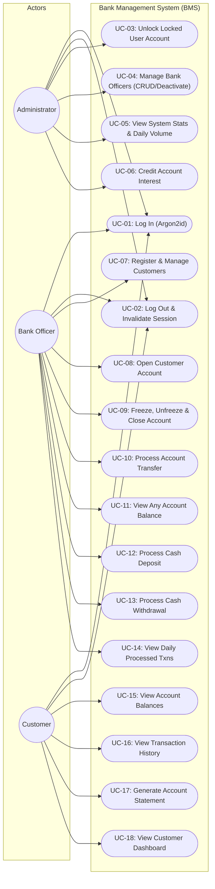

# Software Requirements Specification (SRS) — v1.1 Revision & Gap Fixes

- **Project:** Bank Management System (BMS)
- **Course Code:** `UE24CS341A` (Software Engineering and System Design)
- **Story:** [S-34] Fix SRS gaps: use case diagram, security objectives, references (#65)
- **Version:** 1.1
- **Effective Date:** 1 November 2026

---

## 1. Revision History

| Version | Date | Primary Author(s) | Description of Changes |
| :---: | :---: | :---: | :--- |
| **1.0** | 02 Sep 2026 | Team BMS | Initial draft of Software Requirements Specification. |
| **1.1** | 1 Nov 2026 | Abhishek Kinagi & Team | **Sprint 2 Gap Remediation:** 1. Added Section 5.3 Security Objectives (SO-1, SO-2, SO-3) alongside NFR-4/NFR-5. 2. Corrected course code citations to `UE24CS341A` across all references. 3. Added UML Use Case Diagram covering Administrator, Bank Officer, and Customer roles to Appendix B. 4. Referenced the existing schema-backed ER Diagram source in `design/er-diagram.mmd` (Appendix B). 5. Clarified lockout policy (3 consecutive failures) and administrative unlock workflow (FR-2, FR-13). |

---

## 2. Section 5.3: Security Objectives (Updated)

In addition to Non-Functional Requirements NFR-4 (Credential Protection) and NFR-5 (Audit Trail Completeness), the system enforces the following explicit **Security Objectives**:

- **SO-1: Role-Based Least Privilege Access Control (Confidentiality & Authorization)**
  The system must strictly compartmentalize operations by authenticated role (Administrator, Bank Officer, Customer). Administrative functions (user unlocking, staff creation, audit trail inspection) must be strictly inaccessible to customers and bank officers. Customers must only access records and balances pertaining to their own customer ID.
  
- **SO-2: Authentication Resilience & Brute-Force Mitigation (Integrity & Availability)**
  All stored passwords must be protected using high-work-factor salted cryptographic hashing (Argon2id via libsodium). To mitigate online brute-force credential stuffing, the system must enforce automatic account lockout immediately upon the **third consecutive failed login attempt** (`failed_attempts >= 3`). Locked accounts cannot authenticate until explicitly reinstated by an Administrator via `PATCH /users/:id/unlock`.

- **SO-3: Ephemeral Session Integrity & Invalidation (Session Security)**
  Authenticated sessions must be governed by cryptographically random 64-character tokens stored server-side with a fixed 30-minute lifetime from sign-in. All sessions belonging to a user must be immediately terminated upon user deactivation or explicit logout (`POST /auth/logout`), preventing replay or session hijacking.

---

## 3. References & Course Code Consistency

All references citing the academic curriculum and syllabus are standardized to:
- **Course Code:** `UE24CS341A` — Software Engineering and System Design.
- **Reference 1:** Course Syllabus and Deliverable Guidelines for `UE24CS341A`, Department of Computer Science and Engineering, PES University, Academic Year 2026–2027.
- **Reference 2:** IEEE Std 830-1998, *IEEE Recommended Practice for Software Requirements Specifications*.
- **Reference 3:** OWASP Top 10 API Security Risks (2023 edition), Open Web Application Security Project.

---

## 4. Appendix B: UML Use Case Diagram

The system supports three distinct human actors interacting with the core C++ backend service:

### Entity Relationship Diagram Reference
As required by Part-1 Deliverables Checklist, the relational database design is documented in:
👉 [`design/er-diagram.mmd`](../design/er-diagram.mmd)
It is the schema-backed source for the ER diagram and covers `users`, `customers`, `account_types`, `accounts`, `transactions`, `audit_log`, and `interest_runs`.
